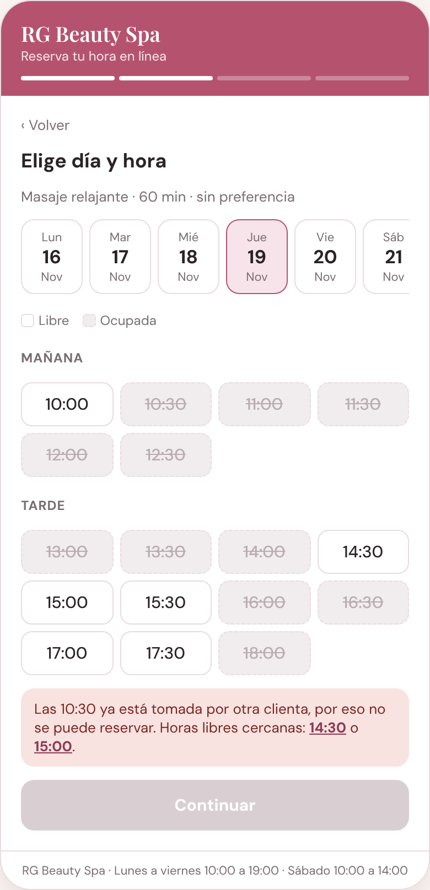
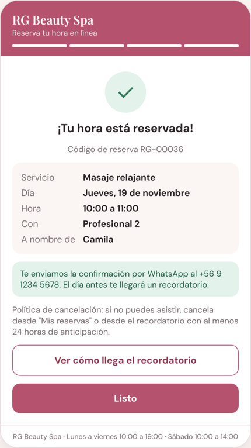
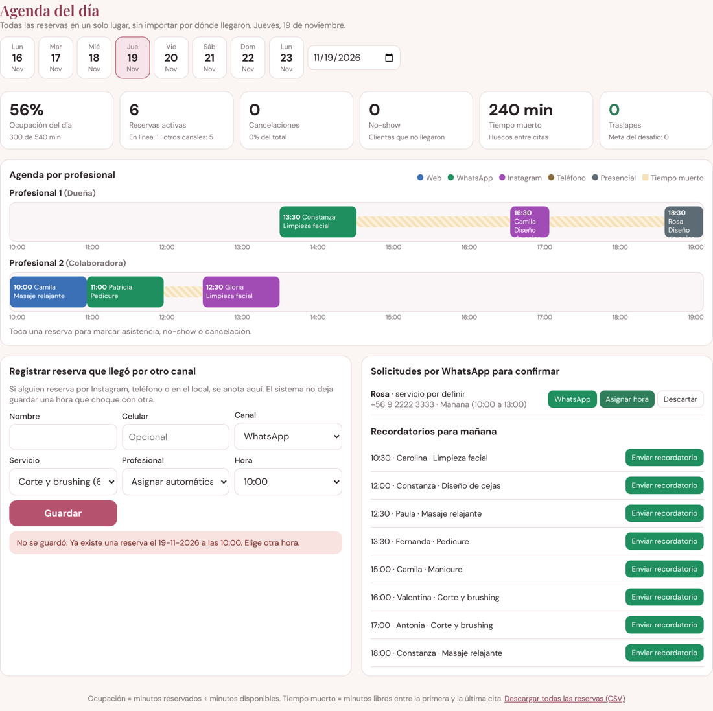
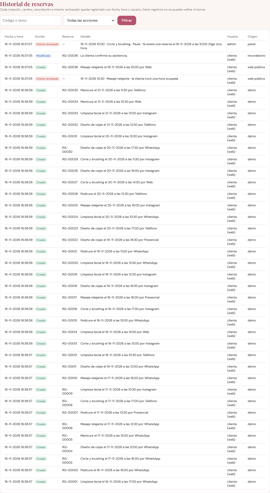

# RG Beauty Spa · Sistema de reservas (Django)

Prototipo del sistema de reservas de RG Beauty Spa hecho en Django con base de datos local (SQLite). Corresponde al Desafío 1 (agendamiento) de Innovación y Emprendimiento III, Ingeniería en Informática, INACAP, Grupo 4.

El problema de fondo es que entre el 60 % y el 70 % de las reservas llegan por WhatsApp e Instagram y quedan anotadas en lugares distintos, por lo que se entregan horas que ya estaban tomadas. El sistema junta todas las reservas en una sola agenda, valida que no se crucen y deja registro de cada movimiento.

## Instalación rápida

Requiere Python 3.10 o superior. El único paquete que necesita es Django (SQLite ya viene con Python), así que todo se instala con `pip install -r requirements.txt`.

**Windows:** doble clic en `iniciar.bat`. Crea el entorno, instala, prepara la base, te pide crear el usuario de la dueña la primera vez y abre el navegador.

**Mac o Linux:** `./iniciar.sh`

**A mano, en una sola línea (PowerShell):**

```
python -m venv .venv; .\.venv\Scripts\pip install -r requirements.txt; .\.venv\Scripts\python manage.py migrate; .\.venv\Scripts\python manage.py createsuperuser; .\.venv\Scripts\python manage.py runserver
```

Luego abre http://127.0.0.1:8000/. La vista clienta es la página principal; el personal entra en "Ingreso personal" con el usuario creado.

`migrate` crea la base `db.sqlite3` y carga el horario (lunes a viernes 10:00 a 19:00, sábado 10:00 a 14:00, domingo cerrado), seis servicios y una profesional. Todo se cambia en Configuración (`/admin/`).

Para la demostración hay reservas de ejemplo: `python manage.py cargar_demo` las crea en los próximos días y `python manage.py cargar_demo --borrar` las cancela.

## Reglas de validación

Se revisan en el modelo `Reserva` (`reservas/models.py`), así que aplican igual en la reserva en línea, en el panel y en el administrador de Django.

| Regla | Mensaje que ve la persona |
| --- | --- |
| Dos reservas vigentes no pueden tener el mismo día y la misma hora | Ya existe una reserva el 18-11-2026 a las 10:00. Elige otra hora. |
| Una reserva no puede cruzarse con otra (por ejemplo 10:00–11:00 y 10:30–11:00) | La hora se cruza con otra reserva (10:00 a 11:00). |
| Debe quedar dentro del horario de atención, incluida la hora de término | La reserva debe quedar dentro del horario de atención (10:00 a 19:00). |
| No se reserva en días cerrados | El spa no atiende ese día. |
| No se reserva en el pasado ni con más de 30 días de anticipación | No se puede reservar en una fecha u hora que ya pasó. |
| La hora calza con bloques de 30 minutos | La hora debe calzar con bloques de 30 minutos. |
| No se reserva sobre un horario bloqueado (almuerzo, trámite) | Ese horario está bloqueado. |
| Celular chileno válido y consentimiento de datos en la reserva en línea | Ingresa un celular chileno válido. |

La regla de mismo día y misma hora también está en la base de datos como restricción única (`una_reserva_por_dia_y_hora`) sobre las reservas no canceladas. Si dos personas confirman la misma hora al mismo tiempo, la segunda recibe el error aunque las validaciones del formulario hayan pasado. Al cancelar una reserva, su hora queda libre.

Las reglas se ajustan en `config/settings.py`, en el bloque `AGENDA`:

- `INTERVALO_MIN`: minutos entre horas disponibles (30).
- `DIAS_ANTICIPACION`: días hacia adelante que se puede reservar (30).
- `AGENDA_POR_PROFESIONAL`: en `False` el spa atiende una reserva a la vez. En `True` cada profesional tiene su propia agenda y dos reservas se pueden cruzar si son con profesionales distintas. La regla de mismo día y misma hora se mantiene en ambos casos.

## Trazabilidad

- Cada reserva tiene un código (RG-00001), fecha de creación, fecha de última modificación y el usuario que la creó (vacío si la hizo la clienta en línea).
- El modelo `HistorialReserva` guarda cada creación, cambio de estado, reprogramación y cancelación, con fecha y hora, usuario y origen (web pública, panel o administración). También guarda los intentos rechazados, por ejemplo cuando alguien intenta tomar una hora ocupada.
- El historial no se puede editar ni borrar, tampoco desde el administrador.
- Las reservas no se borran: se cancelan. El administrador tiene desactivada la opción de eliminar.

## Pantallas

El diseño es el mismo del prototipo v2 de la presentación: la clienta ve un flujo tipo celular de cuatro pasos y la dueña ve la "Agenda del día".

| Ruta | Quién | Qué hace |
| --- | --- | --- |
| `/` | Clienta | Servicio y profesional ("Sin preferencia" por defecto), día y hora, datos y confirmación. Si toca una hora ocupada, se le explica que está tomada y se sugieren dos horas libres cercanas |
| `/reserva/<código>/recordatorio/` | Clienta | Simulación del recordatorio por WhatsApp con botones para confirmar, cambiar o cancelar; la respuesta queda en el historial |
| `/whatsapp/` | Clienta | Reserva asistida: deja nombre, celular y preferencia, y la solicitud aparece en el panel |
| `/mis-reservas/` | Clienta | Busca sus reservas con el celular y las cancela |
| `/panel/` | Personal | Indicadores del día, agenda por profesional con el canal de cada reserva por color y los tiempos muertos marcados, registro de reservas de otros canales, solicitudes por WhatsApp y recordatorios para mañana. Al tocar una reserva se marca asistió, no llegó o cancelada |
| `/panel/historial/` | Personal | Historial completo con filtros por código y acción |
| `/panel/exportar.csv` | Personal | Descarga todas las reservas para Excel |
| `/admin/` | Personal | Servicios, profesionales, horario, bloqueos, clientas, solicitudes y reservas |

<p>


</p>




## Pruebas

```bash
python manage.py test reservas
```

Son 28 pruebas que cubren la regla de mismo día y misma hora (en el formulario y en la base de datos), cruces, horario, días cerrados, fechas pasadas, bloqueos, reactivación de reservas canceladas, reservas anotadas desde el panel sin celular, el recordatorio, las solicitudes por WhatsApp, el historial y el acceso al panel.

## Versión sin servidor

La carpeta `version-web/` tiene la versión anterior en un solo archivo HTML que guarda los datos en el navegador. Sirve para mostrar el flujo sin instalar nada.

## Equipo

Carlos Pizarro, Oscar Acevedo, Milowan Martínez y Sondra Guerra. Profesor: Iván Muñoz.
