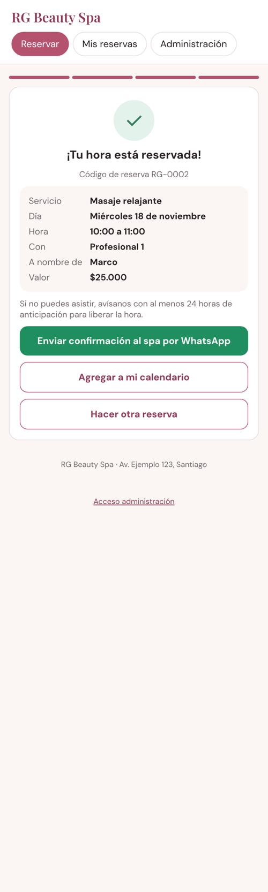
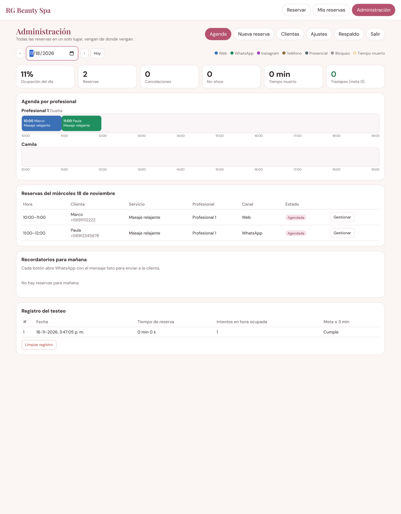

# RG Beauty Spa · Sistema de reservas

Sistema de reservas en línea para RG Beauty Spa, listo para usar en el navegador. Corresponde al Desafío 1 (agendamiento) de Innovación y Emprendimiento III, Ingeniería en Informática, INACAP, Grupo 4.

**Abrir:** https://elmilo1.github.io/RgPrototipo/

## El problema que resuelve

Entre el 60 % y el 70 % de las reservas del spa llegan por WhatsApp e Instagram, y cada una queda anotada en un lugar distinto. Por eso se entregan horas que ya estaban tomadas y la dueña tiene que dejar de atender para contestar. Este sistema junta todas las reservas en una sola agenda: las que hace la clienta en línea y las que la dueña anota cuando llegan por otro canal.

## Para la clienta

- Elige servicio, profesional, día y hora. Solo puede tomar horas libres; si toca una ocupada, el sistema le sugiere dos horas cercanas.
- Deja nombre y celular (correo opcional) y acepta el uso de sus datos.
- Recibe un código de reserva, puede avisar al spa por WhatsApp con un mensaje ya escrito y agregar la cita a su calendario.
- En "Mis reservas" busca sus horas con el celular y puede cancelarlas.
- Si prefiere conversar, el botón "Prefiero reservar por WhatsApp" abre el chat del spa.

## Para la administración

Se entra con el enlace "Acceso administración" al final de la página. El PIN inicial es **1234** y se cambia en Ajustes.

- **Agenda:** línea de tiempo por profesional con el canal de cada reserva marcado por color, tiempos muertos señalados y lista del día. Cada reserva se puede marcar como asistió, no llegó o cancelada.
- **Indicadores del día:** ocupación, reservas, cancelaciones, no-show, minutos de tiempo muerto y traslapes.
- **Recordatorios para mañana:** un botón por clienta que abre WhatsApp con el recordatorio listo para enviar.
- **Nueva reserva:** para anotar lo que llega por WhatsApp, Instagram, teléfono o en el local, o para bloquear un horario. Si la hora choca con otra, no se guarda.
- **Clientas:** historial por celular, acceso directo a WhatsApp y botón para borrar sus datos (Ley 21.719).
- **Ajustes:** nombre, WhatsApp y dirección del spa, horario por día, servicios con duración y precio, profesionales, política de cancelación, PIN y modo testeo.
- **Respaldo:** descarga de reservas en CSV (se abre en Excel), respaldo completo en JSON, restauración y reservas de ejemplo para demostraciones.

## Primeros pasos

1. Entra a Administración → Ajustes.
2. Escribe el WhatsApp del spa, revisa el horario, los servicios con sus precios y las profesionales, y cambia el PIN.
3. Presiona "Guardar ajustes" y comparte el enlace con las clientas.

## Límites de esta versión

Los datos se guardan en el navegador del equipo donde se usa (almacenamiento local). Por eso conviene usarlo en un solo equipo, por ejemplo el computador o la tablet de recepción, y descargar respaldos seguido. Las reservas hechas desde el celular de una clienta no aparecen solas en el equipo del spa: para eso la clienta envía la confirmación por WhatsApp y la dueña la anota, o se pasa a una versión con base de datos compartida.

Los mensajes de WhatsApp se abren con el texto prellenado y se envían a mano; no hay envío automático. El PIN evita que una clienta entre al panel por error, pero no es una protección fuerte.

## Modo testeo

Al activarlo en Ajustes, cada reserva hecha desde "Reservar" registra cuánto demoró y cuántas veces se intentó tomar una hora ocupada. La tabla aparece al final de la Agenda y sirve para la ficha de testeo (meta: reservar en 3 minutos o menos y 0 horas ocupadas ofrecidas).

## Capturas

## Tecnología

Un solo archivo `index.html` con HTML, CSS y JavaScript, sin dependencias ni instalación. Se publica con GitHub Pages.

## Equipo

Carlos Pizarro, Oscar Acevedo, Milowan Martínez y Sondra Guerra. Profesor: Iván Muñoz.
