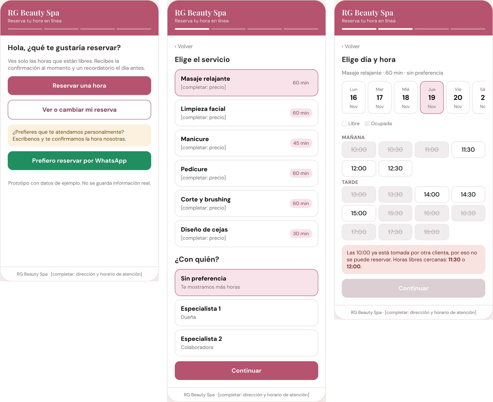
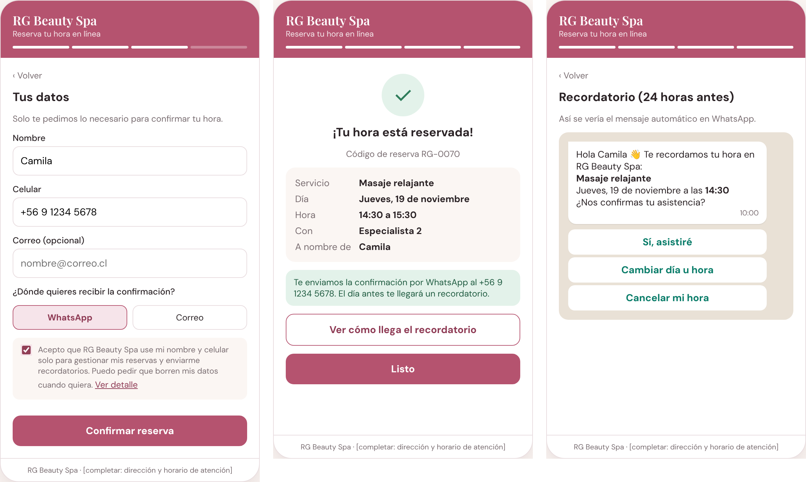
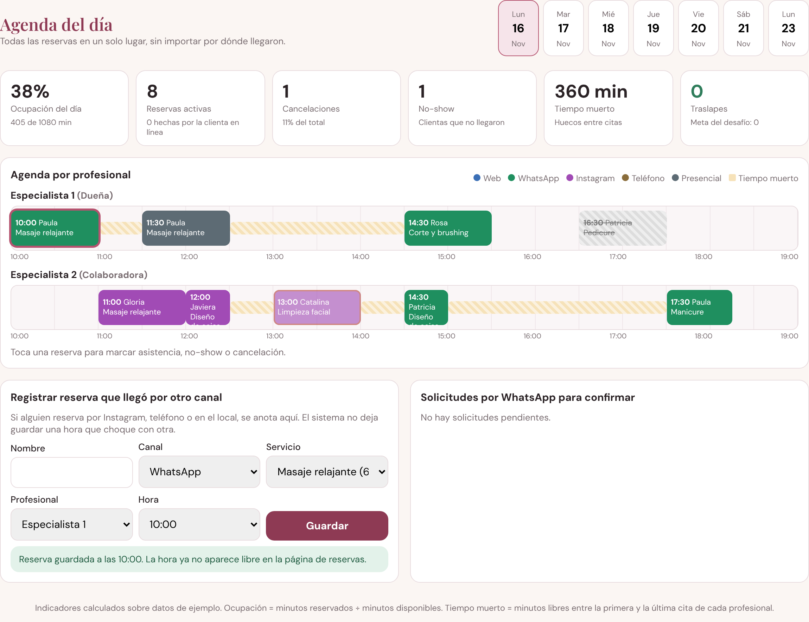

# RG Beauty Spa · Prototipo de reservas

Prototipo navegable del sistema de reservas en línea para RG Beauty Spa. Corresponde al Desafío 1 (agendamiento) de la asignatura Innovación y Emprendimiento III de Ingeniería en Informática, INACAP, Grupo 4.

**Ver el prototipo:** https://elmilo1.github.io/RgPrototipo/

## El problema

Entre el 60 % y el 70 % de las reservas del spa llegan por WhatsApp e Instagram, y cada una queda anotada en un lugar distinto: la agenda física, el chat o los mensajes directos. Por eso se entregan horas que ya estaban tomadas y la dueña tiene que dejar de atender para contestar.

El desafío quedó redefinido así: ¿cómo podríamos centralizar el registro de reservas, sin perder la cercanía de WhatsApp e Instagram, para eliminar los traslapes de agenda y reducir los tiempos muertos?

## Qué hace el prototipo

**Vista clienta**

1. Elige el servicio y la profesional, o deja "Sin preferencia" para ver más horas.
2. Elige día y hora. Las horas ocupadas aparecen tachadas. Si toca una, el sistema explica que está tomada y sugiere dos horas libres cercanas.
3. Ingresa nombre y celular (el correo es opcional) y acepta el uso de sus datos.
4. Recibe la confirmación con un código de reserva.
5. Puede ver cómo llega el recordatorio por WhatsApp 24 horas antes, con botones para confirmar, cambiar o cancelar.

También puede buscar y cancelar su reserva con el celular, o pedir que la atiendan por WhatsApp si prefiere conversar.

**Panel de la dueña**

- Agenda del día por profesional, con cada reserva coloreada según el canal por el que llegó.
- Indicadores del día: ocupación, cancelaciones, no-show, minutos de tiempo muerto y traslapes.
- Formulario para anotar reservas que llegan por WhatsApp, Instagram, teléfono o en el local. Si la hora choca con otra, no la guarda y dice con quién choca.
- Bandeja de solicitudes de reserva asistida.
- Opción para marcar si la clienta asistió, no llegó o canceló.

**Modo testeo**

Al activarlo en la barra superior, el prototipo registra cuánto demora cada reserva y cuántas veces se intentó tomar una hora ocupada. Esa tabla aparece al final del panel de la dueña y sirve para la ficha de testeo (meta: reservar en 3 minutos o menos y 0 horas ocupadas ofrecidas).

## Capturas

## Cómo usarlo

Es un solo archivo HTML, sin instalación. Se abre desde el enlace de GitHub Pages o descargando `index.html` y abriéndolo en el navegador. Funciona en celular y computador.

Trabaja con datos de ejemplo: los servicios, las profesionales y las reservas de la agenda son ficticios, y nada se guarda al recargar la página. El envío de mensajes de WhatsApp está simulado.

## Indicadores

- Ocupación = minutos reservados ÷ minutos disponibles de todas las profesionales.
- Tiempo muerto = minutos libres entre la primera y la última cita de cada profesional.
- Traslapes = pares de reservas activas de una misma profesional que se cruzan.

## Equipo

Carlos Pizarro, Oscar Acevedo, Milowan Martínez y Sondra Guerra. Profesor: Iván Muñoz.
